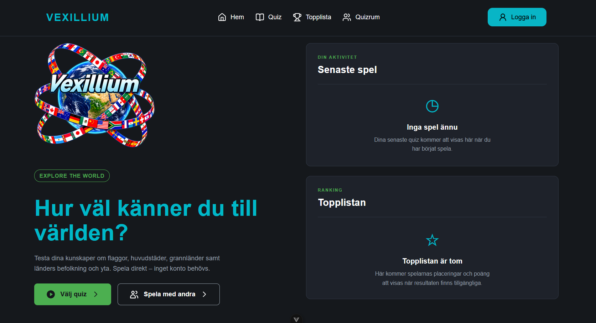
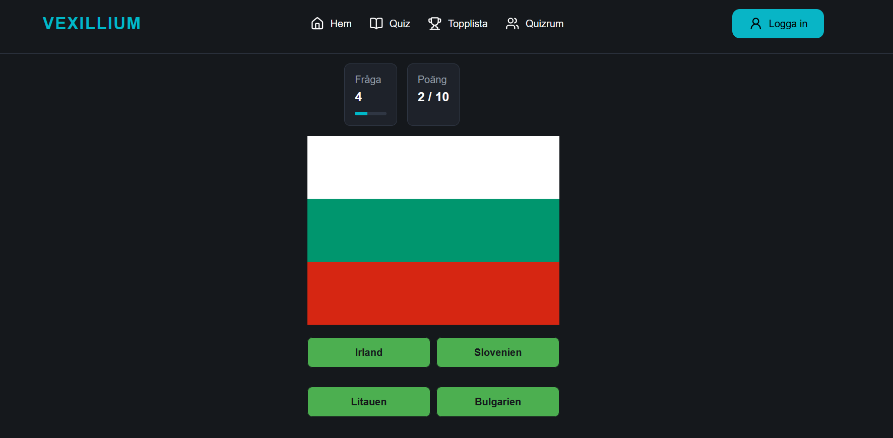
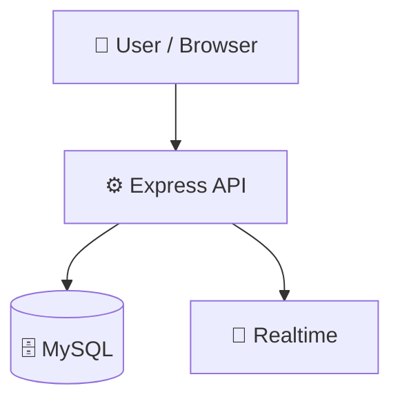

# Vexillium

   

## 📑 Table of Contents

- [Description](#description)
- [Screenshots](#screenshots)
- [Tech Stack](#tech-stack)
- [Architecture](#architecture)
- [Quick Start](#quick-start)
- [Key Dependencies](#key-dependencies)
- [API Endpoints](#api-endpoints)
- [Project Structure](#project-structure)
- [Development Setup](#development-setup)
- [Contributors](#contributors)
- [Contributing](#contributing)

## 📝 Description

Vexillium — a backend api built with Docker, Express.js, JavaScript, MySQL, Vite.

## 📸 Screenshots





## 🛠️ Tech Stack

    

**Notable libraries:** Socket.IO

## 🏗️ Architecture

A high-level view of how the main pieces fit together:



## ⚡ Quick Start

```bash

# 1. Clone the repository
git clone https://github.com/donne41/Vexillium.git

# 2. Install dependencies
npm install

# 3. Start the dev server
npm run dev

# 4. Start docker
docker compose up -up in backend

# 5. Start backend server
node app.js
```

## 📦 Key Dependencies

```
bcryptjs: ^3.0.3
cors: ^2.8.6
dotenv: ^18.0.7
express: ^5.3.0
express-rate-limit: ^8.7.1
express-session: ^1.19.0
mysql2: ^3.24.6
socket.io: ^4.8.4
```

## 🛠️ Development Setup

### Node.js / JavaScript
1. Install Node.js (v18+ recommended)
2. Install dependencies: `npm install` (or `yarn` / `pnpm install` / `bun install`)
3. Start the dev server: see the **Quick Start** above

## 👥 Contributors

Thanks to everyone who has contributed to this project:

<p align="left">
<a href="https://github.com/donne41" title="donne41"></a>
<a href="https://github.com/Martin-E-Karlsson" title="Martin-E-Karlsson"></a>
<a href="https://github.com/Ericthilen" title="Ericthilen"></a>
<a href="https://github.com/JohanHiths" title="JohanHiths"></a>
</p>

[See the full list of contributors →](https://github.com/donne41/Vexillium/graphs/contributors)
